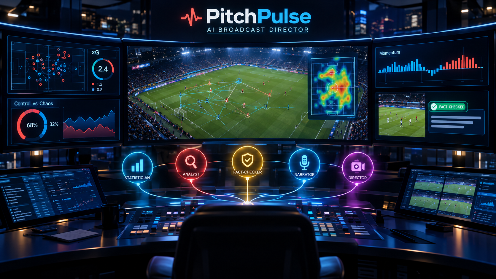
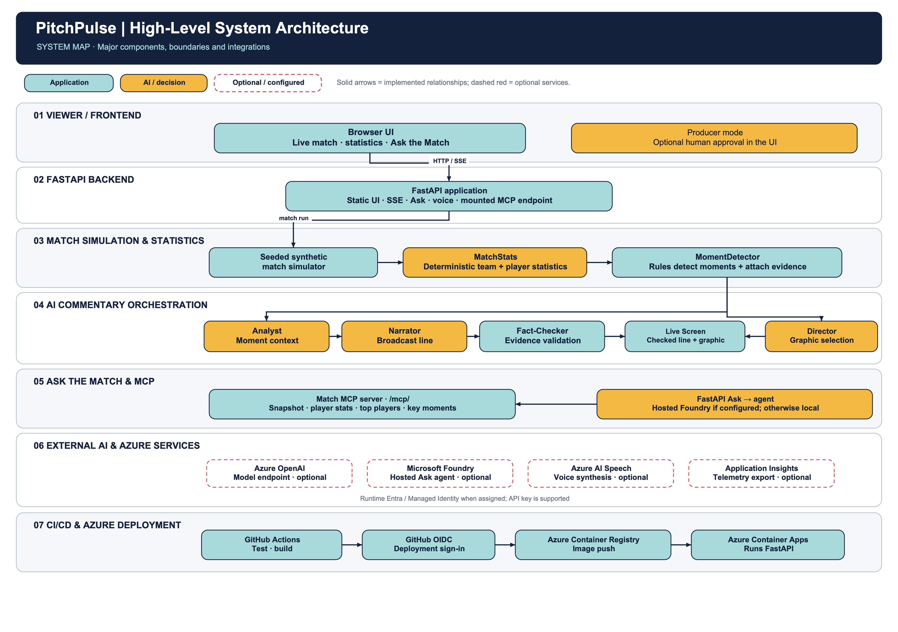
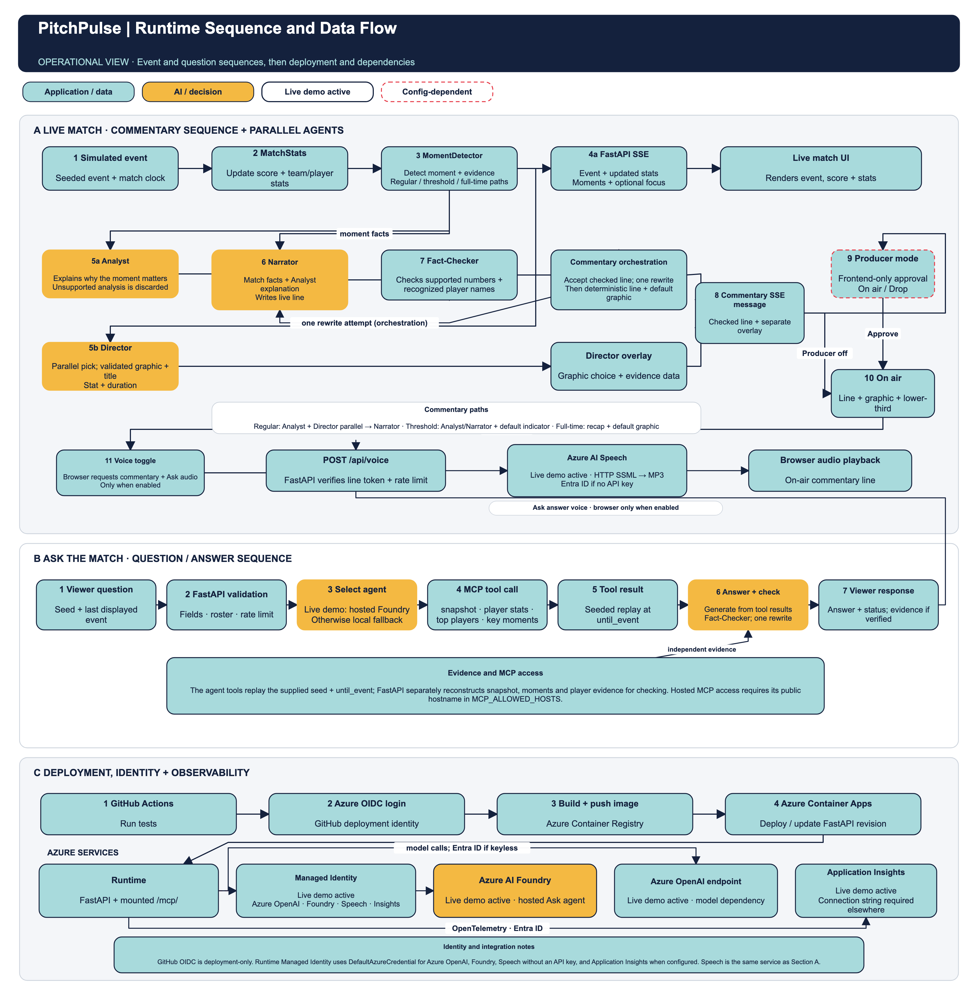

# PitchPulse – AI Broadcast Director

The live demo runs with every AI feature enabled: Foundry agents, Fact-Checker, voice and Application Insights.

PitchPulse is an AI-assisted football broadcast experience built around synthetic match data. It combines deterministic match statistics with specialist AI agents to explain important moments, generate broadcast-style commentary, and select contextual graphics.

Traditional statistics describe **what happened**. PitchPulse helps viewers understand **why it mattered**—while tying explanations to match data.

## Live Demo

[Open the PitchPulse live demo](https://pitchpulse.livelyfield-1dcb67cb.polandcentral.azurecontainerapps.io)

[Watch the demo video (2 min)](https://youtu.be/jB36TWpEmLc)

The demo runs a simulated match; it does not connect to a real-world live football feed. All clubs and players in the simulator are fictional.

## 🎥 Project Demo Video

[Watch the PitchPulse Demo on YouTube](https://www.youtube.com/watch?v=jB36TWpEmLc)

## The Problem

Scorelines and statistics show events and totals, but they do not always explain the context behind a change in momentum, a big chance, or a shift in control. AI can make those moments easier to understand, but an on-air explanation also needs to be grounded in the available match evidence.

## Our Solution

PitchPulse simulates a match and computes its statistics and key moments in code. AI agents can then explain and narrate those moments, while a Fact-Checker checks claims against the evidence. The Director selects an appropriate graphic and display duration. If AI is not configured or a model call fails, deterministic commentary and graphics provide a fallback.

## Key Features

### ⚽ Live Match Intelligence

- Simulated score, match clock, possession, shots, shots on target, expected goals (xG), pass accuracy, and other team statistics.
- A five-minute momentum measure and a **Control vs Chaos** view based on turnovers, completed passes, tempo, and pressing.
- Rule-based detection of goals, big chances, momentum and flow changes, half-time, full-time, and selected speed or distance thresholds.
- Name-tagged speed and distance indicators for shots of at least 110 km/h and completed passes of at least 40 m.
- A broadcast-style interface with a scorebug, animated pitch, live statistics, key moments, lower-thirds, and timed graphics.
- Match speed, seed, and playback controls. The event stream is simulated and can be accelerated; it is not a real-world live data integration.

### 🤖 Multi-Agent AI Broadcast

For a regular detected moment, the Analyst and Director work from shared match evidence in parallel. The application checks the Analyst's explanation, then the Narrator uses the match facts and supported analysis to write a viewer-facing line; the Fact-Checker checks that line. Threshold moments use a default graphic, and full-time uses the recap path. Deterministic templates and default graphics are fallbacks.

### 🎬 Producer Mode

Producer mode is a frontend option: the commentary appears in the moments list, while its on-air lower-third, Director graphic, and spoken audio wait for On air approval; Drop withholds those outputs.

### 🎨 Personalized Viewing

Viewers can choose casual or analyst commentary, select a supported team, follow a player, and choose a focus metric. These preferences influence the tone and emphasis of commentary; the focus metric is highlighted in the live statistics. The player-follow option adds player statistics and moments to the view.

The interface offers English, Albanian, Spanish, French, German, Portuguese, and Arabic. Optional spoken commentary uses Azure AI Speech; AI-generated lines are spoken in the selected language, while template fallback lines use English.

### 💬 Ask the Match

Ask questions about the match as it stands, such as which team is pressing more. The question uses the selected match seed and last event shown. The hosted Foundry agent is used when configured (as in the live demo described here); otherwise an in-process Agent Framework agent is used. Both can call the match MCP tools. Answers are checked against independently replayed match evidence, with one rewrite attempt; verified answers include claim evidence, while unavailable, busy, error, or still-unsupported answers are returned with an appropriate status/message instead.

### 📋 Match Recap

At full-time, PitchPulse can generate a short recap from the result, key-moment timeline, and statistics for each half. As with commentary, a deterministic template is available when AI is not configured or a model call fails.

### 🛡️ Producer and Technical Safeguards

- Match statistics and key-moment detection are computed deterministically, not generated by the language model.
- Commentary and Ask the Match answers are checked against match evidence; unsupported claims trigger a rewrite or are rejected.
- Model-backed features fall back to templates if credentials are missing or a call fails.
- In-memory limits cap questions at 10 per viewer IP per 10 minutes, open match streams at 5 per IP, and model calls at the configured hourly budget (`LLM_CALLS_PER_HOUR`, default `900`).
- Optional OpenTelemetry export sends application and agent traces to Azure Application Insights when `APPLICATIONINSIGHTS_CONNECTION_STRING` is configured.

## Statistics and AI Roles

| Role | Responsibility |
| --- | --- |
| **Statistician (code)** | Computes deterministic match and player statistics, including xG, possession, pass statistics, momentum, and Control vs Chaos. This is code, not an LLM agent or an LLM-generated source of numbers. |
| **Analyst** | Explains why a detected moment matters, using its statistics and evidence. |
| **Director** | Selects a suitable graphic and how long it should remain on screen; its selection is validated and has a deterministic default. |
| **Narrator** | Writes personalized, broadcast-style commentary and the full-time recap. |
| **Fact-Checker** | Checks generated numbers and player references against available evidence. For commentary and Ask the Match, unsupported claims prompt one rewrite; a claim that still fails verification is not presented as a verified AI answer. |

## Ask the Match: Agent and MCP Flow

The Ask the Match assistant uses the Model Context Protocol (MCP) to obtain match data:

1. The viewer's question is sent with the match seed and the last event currently shown.
2. Depending on configuration, the application runs the published `ask-the-match` agent in Microsoft Foundry or an in-process Microsoft Agent Framework agent.
3. The agent queries the match MCP server for data at that seed and event. The server deterministically replays the synthetic match to reconstruct that point in time.
4. The available tools are `match_snapshot`, `player_stats`, `top_players`, and `key_moments`.
5. The answer is checked against the corresponding match snapshot, player statistics, and key moments. Verified claims can be expanded in the interface to show their evidence.

If a configured Foundry agent cannot be reached, the application falls back to the in-process Agent Framework agent. The local agent uses the same match MCP tools.

To publish or update the Foundry agent, set `FOUNDRY_PROJECT_ENDPOINT` and provide an MCP URL reachable by Foundry. The publishing identity needs the **Foundry User** role on the Foundry resource:

```bash
FOUNDRY_PROJECT_ENDPOINT=https://<resource>.services.ai.azure.com/api/projects/<project> \
  python -m pitchpulse.foundry_agent publish https://<app-host>/mcp/
```

Each MCP tool accepts `seed` and `until_event`; `until_event=0` represents the full match. The server exposes streamable HTTP at `/mcp/`.

## System Architecture

The **high-level architecture** diagram shows the system's components, boundaries, and integrations:



The **runtime architecture** diagram shows the chronological commentary and Ask the Match flows, plus deployment, identity, and observability:



The high-level view maps component responsibilities and boundaries. The runtime view follows events and questions in sequence, including the parallel Analyst and Director outputs on the regular commentary path, Fact-Checker validation, the optional frontend Producer gate, and integrations active in the live demo. Threshold moments and full-time recaps take distinct paths. Speech and Application Insights are active in the live demo; both remain configuration-dependent in other deployments.

At a high level, the implemented match flow is:

**Synthetic match events → deterministic statistics and key moments → AI agent orchestration → evidence checks → live broadcast interface**

The simulator emits seeded synthetic events. The Statistician updates match statistics, and rule-based moment detection attaches evidence to notable events. On the regular AI commentary path, Analyst and Director work in parallel; Narrator uses the match facts and supported Analyst explanation, while the Director's separately validated graphic selection joins the checked line in the completed commentary result. The frontend optionally gates on-air presentation of that result. Deterministic templates and default graphics are used when AI is unavailable.

For Ask the Match, the application supplies the current seed and event position to the selected agent. MCP tools replay the synthetic match to that point and return snapshots, player statistics, rankings, or key moments. The answer is checked against independently replayed match evidence; only accepted answers are returned as verified with evidence.

The match stream is served over Server-Sent Events at `GET /api/match/stream`. Each event message includes `{event, stats, moments}` and may include `focus`; agent output arrives as a `{commentary}` message. Commentary includes a timed, machine-readable overlay with fields such as `t`, `period`, `clock`, `graphic`, `title`, `duration_s`, and `data`. If the viewer pauses before the agents finish a line, the browser requests it again from `POST /api/commentary`, so pausing never loses commentary.

For example, the existing interface requests a stream with parameters like:

```text
/api/match/stream?seed=7&speed=30&mode=casual&favorite=home&player=Mateo%20Ruiz&language=Albanian
```

The stream also accepts `start` to resume after an event and `metric` to select a focus metric. The overlay object contains `moment_id`, `t`, `period`, `clock`, `graphic`, `title`, `duration_s`, and graphic-specific `data`; it is structured so a rendering system can synchronize it to the simulated match timeline.

## Technology Stack

| Area | Technologies and use |
| --- | --- |
| Application | Python, FastAPI, and Uvicorn provide the web application and API; the interface uses HTML, CSS, and JavaScript. |
| Match data | A deterministic Python simulator generates synthetic events; Python modules calculate statistics and detect key moments. |
| AI | Microsoft Foundry with the `gpt-4.1-mini` deployment is supported for model calls. Azure identity can be used instead of an API key. |
| Agent orchestration | Microsoft Agent Framework is used for agent calls and the in-process Ask the Match fallback. A published Microsoft Foundry agent can also answer questions. |
| Match data access | Model Context Protocol (MCP) exposes match queries through a streamable HTTP server. |
| Speech | Azure AI Speech text-to-speech is implemented through the HTTP endpoint and `POST /api/voice`; active in the live demo, configuration-dependent in other deployments. The browser requests speech only when Voice is enabled. |
| Hosting and registry | The repository's deployment workflow builds and pushes an image to Azure Container Registry (ACR) and updates Azure Container Apps. |
| Identity and CI/CD | The deployment workflow uses GitHub Actions with OpenID Connect (OIDC) to log in to Azure. The application supports Entra ID credentials, including managed identity in Azure. |
| Observability | OpenTelemetry export to Azure Application Insights is active in the live demo and initializes when `APPLICATIONINSIGHTS_CONNECTION_STRING` is configured; optional in other deployments. |

GitHub Copilot is documented by the team as a development tool; it is not a runtime dependency. MCP clients such as GitHub Copilot can query the match tools.

## How It Works

1. **Simulate:** A seed determines a repeatable match between fictional clubs and players.
2. **Measure:** The Statistician folds events into team and player statistics, including possession, xG, pass accuracy, momentum, and flow.
3. **Detect:** Rule-based logic identifies notable moments and records the supporting match evidence.
4. **Explain and present:** On the regular commentary path, the Analyst and Director run in parallel; Narrator uses the match facts and supported analysis to write commentary, while the Director's validated graphic overlay is joined to the result. The Fact-Checker checks numbers and recognized player names and requests one rewrite if needed. Threshold moments and full-time recaps follow different paths.
5. **Render and personalize:** The browser consumes the event stream and displays the score, pitch, statistics, moments, commentary, and overlays using the viewer's preferences.
6. **Answer questions and recap:** Ask the Match queries the synthetic match through MCP and checks its answer against match data. At full-time, the Narrator can produce a recap from the match timeline and half-by-half statistics.

## Getting Started / Run

### Prerequisites and Python version

- Git.
- Python 3.12, matching the version used by the repository's GitHub Actions workflow and Docker image. The repository does not declare a minimum supported Python version, so Python 3.11 support is not confirmed.
- `pip`, included with standard Python installations.

### Clone the repository

If you have not cloned the project yet, run these commands in PowerShell, Command Prompt, Terminal, or your Linux shell:

```text
git clone https://github.com/Albion-Hoxha/pitchpulse.git
cd pitchpulse
```

If you already have the repository, open a terminal and change to its root directory (the directory containing `requirements.txt` and this `README.md`) instead.

### Windows

#### PowerShell

From the project root, create and activate a virtual environment:

```powershell
py -3.12 -m venv .venv
.\.venv\Scripts\Activate.ps1
```

If PowerShell blocks the activation script, either use the Command Prompt instructions below or allow scripts for this PowerShell process only, then activate:

```powershell
Set-ExecutionPolicy -Scope Process -ExecutionPolicy Bypass
.\.venv\Scripts\Activate.ps1
```

This process-scoped setting does not change the system-wide execution policy.

#### Command Prompt

From the project root, create and activate the virtual environment:

```bat
py -3.12 -m venv .venv
.venv\Scripts\activate.bat
```

### macOS

From the project root, create and activate the virtual environment:

```bash
python3.12 -m venv .venv
source .venv/bin/activate
```

### Linux

From the project root, create and activate the virtual environment:

```bash
python3.12 -m venv .venv
source .venv/bin/activate
```

### Install dependencies and run

After activating the virtual environment in your terminal, install the project dependencies:

```bash
python -m pip install -r requirements.txt
```

Start the FastAPI application:

```bash
python -m uvicorn pitchpulse.server:app
```

Open [http://localhost:8000](http://localhost:8000) in your browser, then press **Kick off**. Keep the server running in that terminal. To stop it, press `Ctrl+C`.

With the virtual environment active, you can also run the deterministic simulator and tests. Run these in another terminal with the virtual environment activated, or after stopping the server:

```bash
python -m pitchpulse.simulator --seed 7
python -m unittest discover tests
```

The simulator prints a match as JSON Lines. The test command runs the project's Python test suite.

### Optional AI configuration

The application can run commentary with deterministic templates without model credentials. To enable the optional AI features, copy `.env.example` to `.env` in the project root, then edit `.env` and replace the example values with your own Azure AI / Foundry settings.

PowerShell:

```powershell
Copy-Item .env.example .env
```

Command Prompt:

```bat
copy .env.example .env
```

macOS or Linux:

```bash
cp .env.example .env
```

Configure the variables provided in `.env.example`:

- `AZURE_OPENAI_ENDPOINT`: Azure AI resource endpoint used for model calls.
- `AZURE_OPENAI_API_KEY`: optional API key. Leave it empty to use Entra ID credentials; for local Azure CLI credentials, sign in with `az login`.
- `AZURE_OPENAI_DEPLOYMENT`: model deployment name; the example uses `gpt-4.1-mini`.
- `FOUNDRY_PROJECT_ENDPOINT`: optional Foundry project endpoint for the published Ask the Match agent.

Restart the application after changing `.env`. Do not commit `.env`; it is git-ignored. Azure AI Speech and Application Insights also depend on their corresponding Azure resource configuration.

## Project Structure

| Path | Purpose |
| --- | --- |
| `pitchpulse/simulator.py` | Seeded synthetic match event generator. |
| `pitchpulse/stats.py` | Deterministic match statistics. |
| `pitchpulse/moments.py` | Rule-based key-moment detection and evidence. |
| `pitchpulse/agents.py` | Commentary, analysis, graphics, fact-checking, and local Ask the Match orchestration. |
| `pitchpulse/mcp_server.py` | Match MCP server and query tools. |
| `pitchpulse/foundry_agent.py` | Publishing and calling the Foundry Ask the Match agent. |
| `pitchpulse/voice.py` | Optional Azure AI Speech integration. |
| `pitchpulse/server.py` | FastAPI application, API endpoints, and match event stream. |
| `static/` | Browser-based broadcast interface. |
| `tests/` | Python unit and integration tests. |
| `docs/` | Project submission material and imagery. |

## Team

- Albion Hoxha
- Afron Makolli
- Rinesa Sekiraça

## Project Notes

The simulator uses fictional clubs and players and synthetic football match data. Its events are generated in code and are not official data from a league or club. Match seeds make simulated matches repeatable.

Additional project documentation:

- [Project submission overview](docs/submission.md)
- [Submission checklist](docs/submission-checklist.md)
